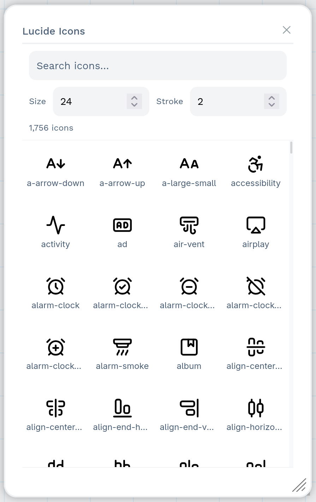

# Penpot Lucide Icons


A Penpot plugin for finding and inserting icons from
[Lucide](https://lucide.dev) into your designs.



## Features

- Browse and search the complete Lucide icon set by name or tag.
- Choose the icon size and stroke width before inserting it.
- Insert icons as editable SVG shapes.
- Supports Penpot's light and dark themes.

## Install

Open a Penpot file, open the Plugin Manager (`Ctrl + Alt + P`), and when asked to add a URL for the plugin you want to install, use:

`https://penpot-lucide-icons.netlify.app`

## Use

1. Open **Lucide Icons** from Penpot's Plugins menu.
2. Search for an icon or browse the grid.
3. Set the size and stroke width.
4. Select an icon to insert it into the centre of the viewport.

Icons are inserted in black and can be recoloured like any other shape in
Penpot.

## Local Development

```bash
npm install
npm run dev
```

Install `http://localhost:4400/manifest.json` in Penpot's Plugin Manager. Run
`npm run build` to create a deployable build in `dist/`.

## License

The plugin is available under the [MIT License](LICENSE). Lucide icons are
available under the ISC License, with some icons derived from Feather under the
MIT License. See [Third-party licenses](THIRD_PARTY_LICENSES).
